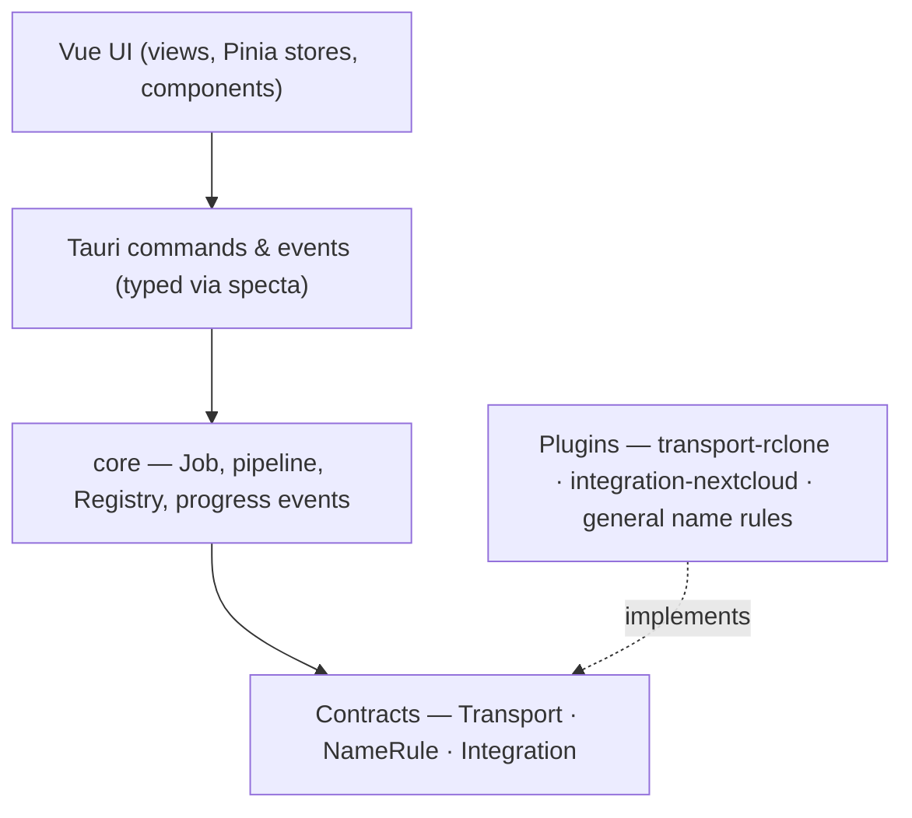
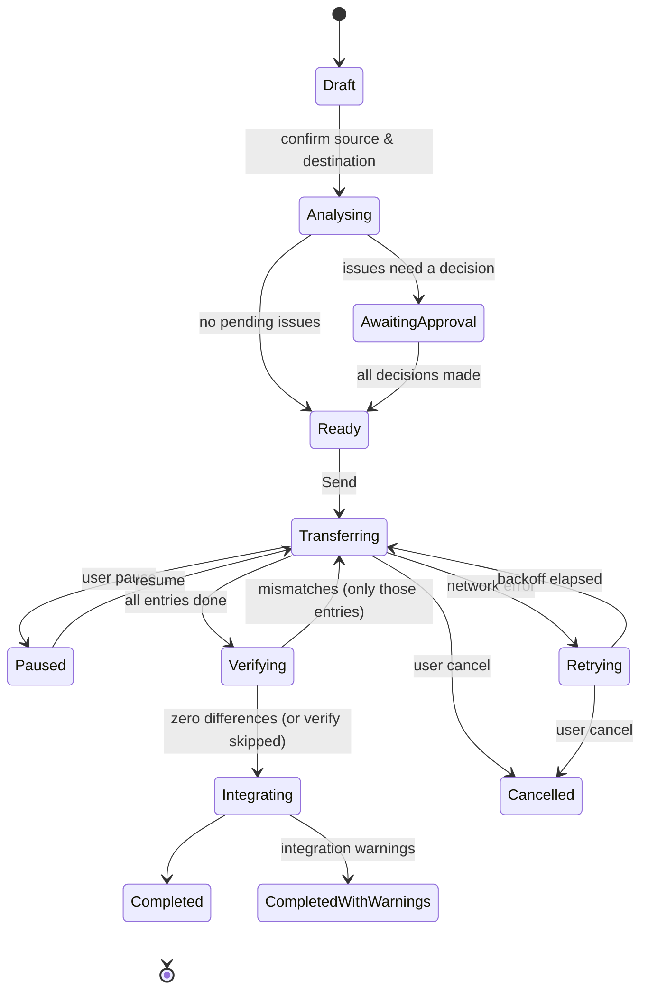

# 02 — Architecture

Every send is a **Job** that goes through **6 stages persisted in SQLite**, so it can stop and
resume at any stage. Every stage uses a contract, never a concrete implementation.

## Pipeline

```mermaid
flowchart LR
    S1["1. Source & destination<br/><small>files, folders, profile</small><br/><i>core · store</i>"]
    S2["2. Analyse<br/><small>names as bytes, free space</small><br/><i>scanner · manifest</i>"]
    S3["3. Fix names<br/><small>source → destination map</small><br/><i>NameRule · approval</i>"]
    S4["4. Transfer<br/><small>resumes on its own, no sleep</small><br/><i>Transport · rclone</i>"]
    S5["5. Verify<br/><small>manifest hash vs destination</small><br/><i>Transport</i>"]
    S6["6. Update tool<br/><small>scan only what changed</small><br/><i>Integration · Nextcloud</i>"]
    S1 --> S2 --> S3 --> S4 --> S5 --> S6
    S5 -- "differences: resend only those files" --> S4
```

| # | Stage | Input | Output (persisted) | Contract |
|---|---|---|---|---|
| 1 | Source & destination | User selection, profile id | `job` row: sources, profile, options | — (`core`, `store`) |
| 2 | Analyse | Source paths | Manifest entries: raw name bytes, size, mtime, (hash); totals; `PreflightReport`s | `Transport::preflight`, `Integration::preflight`, `scanner` |
| 3 | Fix names | Manifest entries, active rules | `issues` + `name_map` (source → destination name), each with `auto` / `pending` / `approved` / `rejected` | `NameRule` |
| 4 | Transfer | Approved name map | Per-entry transfer state (`pending` / `partial` / `done` / `failed`) | `Transport::transfer` |
| 5 | Verify | Manifest hashes | Per-entry verify result; list of mismatches | `Transport::hash` |
| 6 | Update tool | Exact list of changed remote paths | Integration result + report | `Integration::after_transfer` |

Stages 1–3 run **before a single byte is sent**: the user sees and approves everything that will
change. If verification finds differences, **only those files** go back to stage 4.

## Layers

- The UI only talks to `core` (through Tauri commands); `core` only talks to contracts.
- `apps/cli` uses the same `core` — no UI, for servers and scripts.
- Only the app binaries (`apps/desktop/src-tauri`, `apps/cli`) know concrete plugins: they register
  them in the `Registry` at startup.

## Job state machine

Rules:
- Each transition is written to SQLite **before** the next stage starts work.
- On app/service start, `core` loads every job not in a terminal state and resumes it at its
  persisted stage. Entry-level state means a resumed transfer skips completed files.
- `Retrying` uses exponential backoff 30 s → 1 min → 2 min → … capped at 15 min, **unlimited
  retries** until the user cancels ([07](07-security-reliability.md#reliability)).
- `Failed` is reserved for non-retryable errors (auth revoked, destination missing); the UI shows
  the cause and an action.

## Process model

- The **engine runs as a separate process** from the window (`filebridge-service`). Closing the
  window doesn't stop a send; a tray icon stays. On Linux it can install as a `systemd --user` unit.
- The window connects to the service; the service owns SQLite, the rclone sidecar and the sleep
  inhibitor.
- rclone runs as a sidecar (`rclone rcd`) bound to localhost with a random auth token generated per
  start; `transport-rclone` talks to it over HTTP.

> Open implementation detail for Phase 1: the IPC between the Tauri window and the service
> (local socket / named pipe with the same typed messages vs. running core in-process when the
> service isn't installed). Decide during Phase 1 and record an ADR.

## Progress events

`core` emits typed events (generated to TS via specta) that the UI subscribes to:

| Event | Payload (summary) |
|---|---|
| `JobStateChanged` | job id, old → new state, timestamp |
| `ScanProgress` | files counted, bytes counted, current path |
| `TransferProgress` | bytes done/total, files done/total, speed, ETA, current file |
| `EntryFailed` | entry id, error, retry in |
| `VerifyProgress` | entries checked/total, mismatches so far |
| `IntegrationProgress` | step label ("Indexing 3 folders"), done/total, free-text status |
| `JobFinished` | final state, report id |

`ProgressSink` (see [03](03-extension-contracts.md)) is the plugin-facing side of this channel.

## Persistence model (SQLite, `store` crate)

| Table | Purpose |
|---|---|
| `profiles` | Destination profiles (transport id, integration id, host/URL, paths, owner/mode, keyring refs — never secrets) |
| `jobs` | One row per send: profile, options, state, stage, timestamps |
| `job_sources` | Source roots selected for the job |
| `manifest_entries` | One row per file: source path (raw bytes), size, mtime, hash, algo, destination name, transfer state, verify state |
| `issues` | Name issues per entry: rule id, severity, proposal, decision |
| `events` | Append-only log of job events for the detail screen |
| `settings` | Bandwidth limit, schedule, notifications, language |

Schema migrations are embedded in the binary and run at startup. The manifest is what makes
verification independent of the final name: it stores **source hash + destination name**, so a
corrected name never breaks verification.
