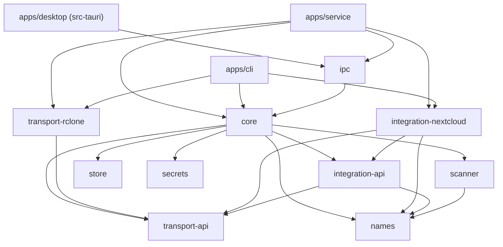

# 08 — Repository structure

A monorepo with a Cargo workspace and a Vue project. Each crate maps to one feature, and the CLI
uses the same core as the app, so it also serves headless servers.

```
filebridge/
├── apps/
│   ├── desktop/                 # Tauri 2 + Vue 3 + TS
│   │   ├── src/                 # interface (views, Pinia stores, components)
│   │   └── src-tauri/           # Tauri commands — thin IPC client of filebridge-service
│   ├── cli/                     # same logic, no UI (servers, scripts)
│   └── service/                 # filebridge-service: hosts the engine, serves ipc (ADR 0008)
├── crates/
│   ├── core/                    # Job, pipeline, states, Registry, progress events
│   ├── ipc/                     # window/CLI ↔ service messages over a local socket
│   ├── scanner/                 # walk source, names as bytes, manifest
│   ├── names/                   # NameRule trait + general rules (NFC, mojibake, forbidden)
│   ├── store/                   # SQLite: jobs, manifests, profiles
│   ├── secrets/                 # OS keyring
│   ├── transport-api/           # Transport trait + types
│   ├── transport-rclone/        # implementation over rclone's rc API
│   ├── integration-api/         # Integration trait + types
│   └── integration-nextcloud/   # WebDAV, direct mode, occ, own rules
├── sidecars/                    # rclone binaries per platform
└── docs/
```

Every folder has its own `README.md` with responsibility, planned API, allowed dependencies and
the phase it lands in.

## Dependency rules



- `core` depends only on `*-api` crates (plus `names`, `scanner`, `store`, `secrets`), **never on
  implementations**.
- Every `transport-*` and `integration-*` crate is independent: **a new plugin is a new crate plus
  one line in the `Registry`**. Plugins never depend on `core`, `store` or `secrets`.
- Only the binaries that host the engine (`apps/service`, `apps/cli`) depend on concrete plugins
  (to register them). The desktop app talks to
  `filebridge-service` through `crates/ipc` ([ADR 0008](adr/0008-service-ipc.md)).
- The interface talks only through typed Tauri commands and events (generated with `specta`), so
  the TS types come from Rust and never drift.

Enforce in CI (Phase 1): a `cargo deny`/`cargo-depgraph` check or a small script that fails if
`crates/core/Cargo.toml` lists a `transport-*`/`integration-*` implementation crate.

## Workspace conventions (to scaffold in Phase 0)

- Root `Cargo.toml` with `[workspace]`, `resolver = "2"`, shared `[workspace.dependencies]`
  versions, `edition = "2021"` (or 2024 if the toolchain allows).
- `pnpm` for the Vue project (`apps/desktop`).
- `rust-toolchain.toml` pinned to stable.
- Package names prefixed `filebridge-` (`filebridge-core`, …) to avoid collisions; folder names
  stay short.

The name `filebridge` is provisional.
