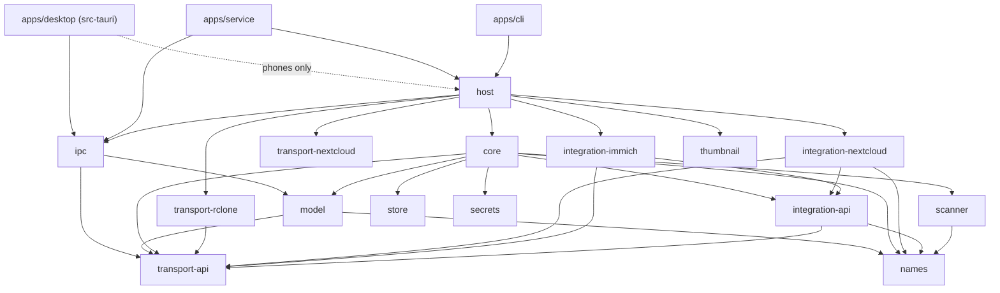

# 08 — Repository structure

A monorepo with a Cargo workspace and a Vue project. Each crate maps to one feature, and the CLI
uses the same core as the app, so it also serves headless servers.

```
filebridge/
├── apps/
│   ├── desktop/                 # Tauri 2 + Vue 3 + TS
│   │   ├── src/                 # interface (views, Pinia stores, components)
│   │   └── src-tauri/           # Tauri commands — thin IPC client of filebridge-service;
│   │       │                    #   on phones the engine itself (ADR 0014)
│   │       └── gen/android/     # Android project: FilebridgePlugin, SendService, SecretVault
│   ├── cli/                     # same logic, no UI (servers, scripts); `filebridge`, installed
│   │                            #   with `cargo install` or in the .deb/.rpm
│   └── service/                 # filebridge-service: hosts the engine, serves ipc (ADR 0008)
├── crates/
│   ├── core/                    # Job, pipeline, states, Registry, progress events
│   ├── host/                    # wiring for engine hosts: data dir + lock, rclone, built-in plugins
│   ├── ipc/                     # window/CLI ↔ service messages over a local socket
│   ├── model/                   # types the UI and the service share + the job state rules
│   ├── scanner/                 # walk source, names as bytes, manifest
│   ├── names/                   # NameRule trait + general rules (NFC, mojibake, forbidden)
│   ├── store/                   # SQLite: jobs, manifests, profiles
│   ├── thumbnail/               # previews of source images, bounded cache (ADR 0027)
│   ├── secrets/                 # OS keyring
│   ├── transport-api/           # Transport trait + types
│   ├── transport-fake/          # local-disk Transport with fault injection (tests, dev mode)
│   ├── transport-nextcloud/     # small files to Nextcloud by bulk upload, in front of rclone
│   ├── transport-rclone/        # implementation over rclone's rc API
│   ├── integration-api/         # Integration trait + types
│   ├── integration-immich/      # Immich external library: checks, scan through its API
│   └── integration-nextcloud/   # WebDAV, direct mode, occ, own rules
├── sidecars/                    # desktop sidecars (prepare-desktop.sh / .ps1 → bin/, not
│                                #   committed), RCLONE_VERSION, licenses/; librclone/ builds
│                                #   rclone as a library
└── docs/
```

Every folder has its own `README.md` with responsibility, planned API, allowed dependencies and
the phase it lands in.

## Dependency rules



- `core` depends only on `*-api` crates (plus `model`, `names`, `scanner`, `store`, `secrets`),
  **never on implementations**.
- `ipc` depends on `model` and `transport-api`, **never on `core`**: a client (the desktop app)
  never compiles the engine, the store or SQLite.
- Every `transport-*` and `integration-*` crate is independent: **a new plugin is a new crate plus
  one line in the `Registry`**. Plugins never depend on `core`, `store` or `secrets`.
- Only the binaries that host the engine (`apps/service`, `apps/cli`, and the app's phone build)
  depend on concrete plugins, through `crates/host`, which registers them. The desktop app talks
  to `filebridge-service` through `crates/ipc` ([ADR 0008](adr/0008-service-ipc.md)). On Android
  and iOS the app depends on `crates/host` itself and its commands call
  `host::EngineOperations`, the same `ipc::Operations` contract
  ([ADR 0014](adr/0014-engine-in-the-app-on-phones.md)).
- The interface talks only through typed Tauri commands and events (generated with `specta`), so
  the TS types come from Rust and never drift.
- The desktop app runs the `filebridge-service` binary (to start it, and its `show-user-unit`,
  `install-user-unit` and `uninstall-user-unit` behind Settings → "Start the engine when I log
  in", [ADR 0028](adr/0028-login-start-on-every-desktop-os.md)) but never links it. The
  installers carry it, the CLI and the pinned rclone as Tauri sidecars
  (`apps/desktop/src-tauri/tauri.bundle.conf.json`, filled by `sidecars/prepare-desktop.sh`, or
  `prepare-desktop.ps1` on Windows), installed beside the app's binary, which is where the
  window and the service look first. The .deb and .rpm also install the CLI's man pages and
  shell completions.

Enforce in CI (Phase 1): a `cargo deny`/`cargo-depgraph` check or a small script that fails if
`crates/core/Cargo.toml` lists a `transport-*`/`integration-*` implementation crate.

## Workspace conventions (to scaffold in Phase 0)

- Root `Cargo.toml` with `[workspace]`, `resolver = "2"`, shared `[workspace.dependencies]`
  versions, `edition = "2021"` (or 2024 if the toolchain allows).
- `pnpm` for the Vue project (`apps/desktop`).
- `rust-toolchain.toml` pinned to stable.
- Package names prefixed `filebridge-` (`filebridge-core`, …) to avoid collisions; folder names
  stay short.

The name `filebridge` is final ([ADR 0032](adr/0032-keep-the-name-filebridge.md)).
