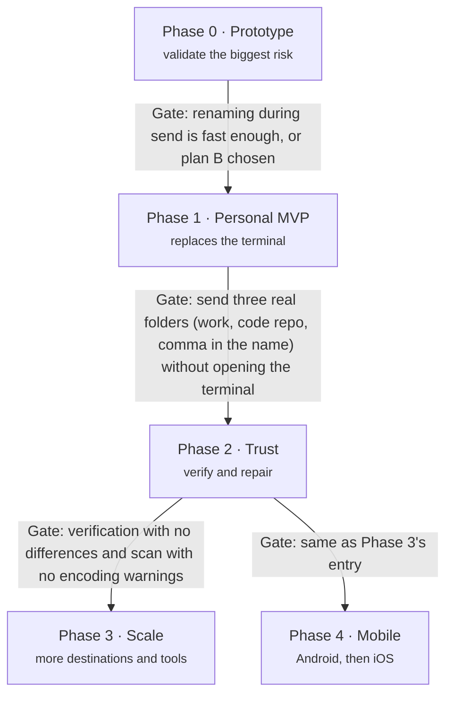

# 09 — Roadmap

Five phases, each closed by a concrete test (gate). **Phase 1 already solves the real use case**;
everything after makes it safer or more general.

No dates: they depend on free time outside work. Phase 0 is deliberately small and must come
first, because its result can change the name-correction architecture.

## Phase 0 — Prototype (validates the biggest risk)

- [x] Install Rust toolchain and rclone locally.
- [x] Scaffold the Cargo workspace (`apps/cli`, `crates/transport-api`, `crates/transport-rclone`,
      `crates/names` with only the NFC rule, `crates/scanner`).
- [x] Rust CLI that controls rclone through the `rc` API (`rclone rcd`, `operations/copyfile`,
      `sync/copy`, `core/stats`, `job/status`).
- [x] Send a folder over SFTP with NFC-corrected names, **file by file**.
- [ ] Measure speed on the real `Backup` folder: files/s and MB/s, per-file rename vs a plain
      `sync/copy` baseline.
- [x] Prototype plan B for comparison: send to a temp folder with original names, batch rename at
      the destination, move into place.
- [ ] Record the result as an ADR (plan A or plan B).
      Draft: [ADR 0007](adr/0007-rename-in-transit-strategy.md) (Proposed, plan A), pending the
      real-server run. Simulated results: [benchmarks/phase-0-simulated.md](benchmarks/phase-0-simulated.md).

**Gate:** renaming during send is fast enough, or plan B is chosen.

> **Status (2026-10-21):** passed provisionally on the simulated results (plan A). Phase 1
> started; the real-server run can still reopen ADR 0007.

## Phase 1 — Personal MVP (replaces the terminal)

- [x] Tauri + Vue app with the 5-step wizard and the job list.
- [x] `crates/store` (SQLite + migrations), `crates/core` (Job, pipeline, state machine, Registry,
      events), `crates/ipc` with `specta` types. The CLI drives the engine end to end.
- [x] TypeScript bindings generated for the desktop app (`specta`, Wave 3).
- [x] NFC and forbidden-character rules (`nfc`, `forbidden-chars`, `trailing`, `reserved`).
- [x] SFTP profile, automatic resume with backoff (crash-tested: `kill -9` mid-send, then resume).
- [ ] Nextcloud direct mode: LXC detection (through the Proxmox node, or SSH straight into the
      Nextcloud machine — ADR 0009), owner `100033`, scan by path. *Code and CLI
      done; not yet run against the real server.*
- [x] Engine as a background service (`filebridge-service`, `systemd --user` unit) and sleep
      inhibit.
- [x] Decide and record the window ↔ service IPC ([ADR 0008](adr/0008-service-ipc.md)).
- [x] Design foundation and navigation ([design 01](design/01-design-system.md),
      [02](design/02-information-architecture.md)), the transfer queue
      ([D04](design/specs/D04-transfer-queue.md)) and the persisted job log
      ([D07](design/specs/D07-job-log-and-activity.md)).
- [x] App-wide bandwidth limit and daily send window in Settings and the CLI
      ([ADR 0010](adr/0010-bandwidth-limit-and-send-window.md)).

**Gate:** send three real folders — a large work folder, a code repository and one with a comma in its name — without opening the terminal.

## Phase 2 — Trust (verify and repair)

- [x] Manifest with hash and verification independent of names (verify keeps each source
      SHA-256; shown per file in [D05](design/specs/D05-files-and-entry-detail.md)).
- [x] Repair destination; mojibake and collision detection (also `encoding` decoding and
      `length`; [04](04-name-correction.md)).
- [x] Nextcloud over WebDAV; credentials in the keyring; restricted SSH key and "Remove access"
      ([05](05-integration-nextcloud.md), [ADR 0004](adr/0004-os-keyring-secrets.md),
      [ADR 0012](adr/0012-own-ssh-key-with-restrict.md)). *Tested against local WebDAV and SFTP
      servers (rclone serve) and the system keyring; not yet run against the real Nextcloud and
      SSH servers.*

**Gate:** verification with no differences and a scan with no encoding warnings.

## Phase 3 — Scale (more destinations and tools)

- [ ] New `Transport`s (SMB, S3) and a second integration (e.g. Immich).
- [ ] Scheduled sends and published CLI.
- [ ] Signed installers and automatic updates.

**Gate (test):** a new plugin enters without changing `core`.

## Phase 4 — Mobile

*Proposed* ([ADR 0013](adr/0013-phones-as-a-source-android-first.md),
[ADR 0014](adr/0014-engine-in-the-app-on-phones.md), plan in [11 — Mobile](11-mobile.md)). Starts
after the Phase 2 gate and can run alongside Phase 3. The phone is a Source: the same app, with
the engine in the app process and rclone linked in as librclone.

### Phase 4a — Android

- [x] Seams on desktop: `RcCall` in `transport-rclone`, the data folder from the app,
      `Host::open_with_secrets`, `Operations` chosen by `cfg(mobile)` in the Tauri app.
- [x] librclone cross-compiled for `arm64-v8a` and `x86_64` (`sidecars/librclone`); `Librclone`
      passes the transport contract suite.
- [x] Tauri Android project and plugin: foreground service, wake and Wi-Fi locks, "All files
      access", folder picker.
- [x] Android Keystore store (the app's `SecretVault`, behind `SecretStore`).
- [x] UI without the desktop-only parts (checked on an emulator at 1080×2400).
- [ ] Run the gate on a real phone (passed on an Android 15 emulator, see
      [11](11-mobile.md#as-built-2026-10-22)).
- [x] "Trust this host key" for SSH profiles on a phone (ADR 0015; checked on an Android 15
      emulator, see [11](11-mobile.md#ssh-host-keys-on-a-phone-2026-10-24)).

**Gate:** from an Android phone, send a real folder with at least 1,000 photos and videos to
Nextcloud over WebDAV; turn the screen off and switch apps mid-send; force-stop the app once and
see the Job resume; the verification has zero differences.

### Phase 4b — iOS

Needs a Mac (Xcode) and an Apple Developer account.

- [ ] librclone as `c-archive` for `aarch64-apple-ios`.
- [ ] Tauri iOS project; Swift plugin for the folder picker and security-scoped bookmarks.
- [ ] Keychain through `keyring`'s `apple-native`.

**Gate:** send a folder from the Files app to Nextcloud over WebDAV, leaving the app and coming
back mid-send; the Job resumes and the verification has zero differences.

## Design work (built, on `main`)

Everything in [design/](design/README.md) is built: the design system, the navigation, and
D01–D11. Each spec says, under "As built", where the code differs and what is left for later.
Two Phase 2 items now have their foundation:

- [x] [D05](design/specs/D05-files-and-entry-detail.md): the manifest keeps each file's SHA-256.
- [x] Repair destination: `Transport::list` ([D11](design/specs/D11-destination-browser.md))
      lists a remote folder, and `Transport::move_path` renames there (Phase 2).
