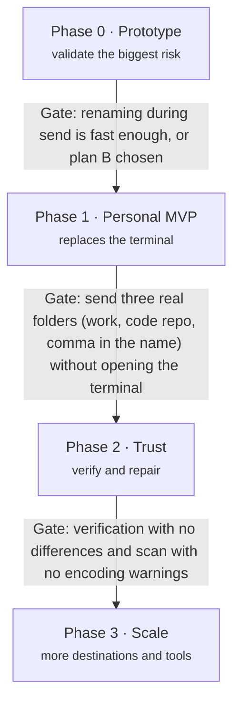

# 09 — Roadmap

Four phases, each closed by a concrete test (gate). **Phase 1 already solves the real use case**;
everything after makes it safer or more general.

No dates: they depend on free time outside work. Phase 0 is deliberately small and must come
first, because its result can change the name-correction architecture.

## Phase 0 — Prototype (validates the biggest risk)

- [x] Install Rust toolchain and rclone locally.
- [x] Scaffold the Cargo workspace (`apps/cli`, `crates/transport-api`, `crates/transport-rclone`,
      `crates/names` with only the NFC rule, `crates/scanner`).
- [x] Rust CLI that controls rclone through the `rc` API (`rclone rcd`, `operations/copyfile`,
      `sync/copy`, `core/stats`, `job/status`).
- [x] Send a folder over SFTP with NFC-corrected names, **file by file**.
- [ ] Measure speed on the real `Backup` folder: files/s and MB/s, per-file rename vs a plain
      `sync/copy` baseline.
- [x] Prototype plan B for comparison: send to a temp folder with original names, batch rename at
      the destination, move into place.
- [ ] Record the result as an ADR (plan A or plan B).
      Draft: [ADR 0007](adr/0007-rename-in-transit-strategy.md) (Proposed, plan A), pending the
      real-server run. Simulated results: [benchmarks/phase-0-simulated.md](benchmarks/phase-0-simulated.md).

**Gate:** renaming during send is fast enough, or plan B is chosen.

> **Status (2026-10-21):** passed provisionally on the simulated results (plan A). Phase 1
> started; the real-server run can still reopen ADR 0007.

## Phase 1 — Personal MVP (replaces the terminal)

- [ ] Tauri + Vue app with the 5-step wizard and the job list.
- [ ] `crates/store` (SQLite + migrations), `crates/core` (Job, pipeline, state machine, Registry,
      events), `specta` bindings.
- [ ] SFTP profile, NFC and forbidden-character rules, automatic resume with backoff.
- [ ] Nextcloud direct mode: LXC detection, owner `100033`, scan by path.
- [ ] Engine as a background service and sleep inhibit.
- [x] Decide and record the window ↔ service IPC ([ADR 0008](adr/0008-service-ipc.md)).

**Gate:** send three real folders — a large work folder, a code repository and one with a comma in its name — without opening the terminal.

## Phase 2 — Trust (verify and repair)

- [ ] Manifest with hash and verification independent of names.
- [ ] Repair destination; mojibake and collision detection.
- [ ] Nextcloud over WebDAV; credentials in the keyring; restricted SSH key and "Remove access".

**Gate:** verification with no differences and a scan with no encoding warnings.

## Phase 3 — Scale (more destinations and tools)

- [ ] New `Transport`s (SMB, S3) and a second integration (e.g. Immich).
- [ ] Scheduled sends and published CLI.
- [ ] Signed installers and automatic updates.

**Gate (test):** a new plugin enters without changing `core`.
