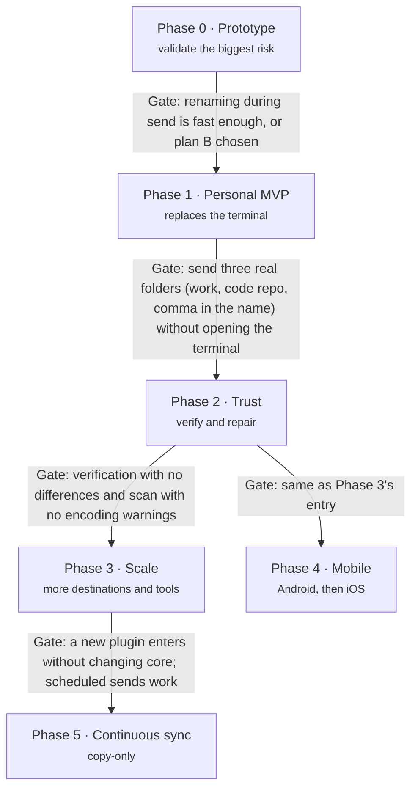

# 09 — Roadmap

Six phases, each closed by a concrete test (gate). **Phase 1 already solves the real use case**;
everything after makes it safer or more general.

No dates: they depend on free time outside work. Phase 0 is deliberately small and must come
first, because its result can change the name-correction architecture.

## Phase 0 — Prototype (validates the biggest risk)

- [x] Install Rust toolchain and rclone locally.
- [x] Scaffold the Cargo workspace (`apps/cli`, `crates/transport-api`, `crates/transport-rclone`,
      `crates/names` with only the NFC rule, `crates/scanner`).
- [x] Rust CLI that controls rclone through the `rc` API (`rclone rcd`, `operations/copyfile`,
      `sync/copy`, `core/stats`, `job/status`).
- [x] Send a folder over SFTP with NFC-corrected names, **file by file**.
- [ ] Measure speed on the real `Backup` folder: files/s and MB/s, per-file rename vs a plain
      `sync/copy` baseline.
- [x] Prototype plan B for comparison: send to a temp folder with original names, batch rename at
      the destination, move into place.
- [ ] Record the result as an ADR (plan A or plan B).
      Draft: [ADR 0007](adr/0007-rename-in-transit-strategy.md) (Proposed, plan A), pending the
      real-server run. Simulated results: [benchmarks/phase-0-simulated.md](benchmarks/phase-0-simulated.md).

**Gate:** renaming during send is fast enough, or plan B is chosen.

> **Status (2026-10-21):** passed provisionally on the simulated results (plan A). Phase 1
> started; the real-server run can still reopen ADR 0007.

## Phase 1 — Personal MVP (replaces the terminal)

- [x] Tauri + Vue app with the 5-step wizard and the job list.
- [x] `crates/store` (SQLite + migrations), `crates/core` (Job, pipeline, state machine, Registry,
      events), `crates/ipc` with `specta` types. The CLI drives the engine end to end.
- [x] TypeScript bindings generated for the desktop app (`specta`, Wave 3).
- [x] NFC and forbidden-character rules (`nfc`, `forbidden-chars`, `trailing`, `reserved`).
- [x] SFTP profile, automatic resume with backoff (crash-tested: `kill -9` mid-send, then resume).
- [ ] Nextcloud direct mode: LXC detection (through the Proxmox node, or SSH straight into the
      Nextcloud machine — ADR 0009), owner `100033`, scan by path. *Code and CLI
      done; not yet run against the real server.*
- [x] Engine as a background service (`filebridge-service`, `systemd --user` unit) and sleep
      inhibit.
- [x] Decide and record the window ↔ service IPC ([ADR 0008](adr/0008-service-ipc.md)).
- [x] Design foundation and navigation ([design 01](design/01-design-system.md),
      [02](design/02-information-architecture.md)), the transfer queue
      ([D04](design/specs/D04-transfer-queue.md)) and the persisted job log
      ([D07](design/specs/D07-job-log-and-activity.md)).
- [x] App-wide bandwidth limit and daily send window in Settings and the CLI
      ([ADR 0010](adr/0010-bandwidth-limit-and-send-window.md)).
- [x] One install, no terminal: the installers carry `filebridge-service` and the pinned rclone
      as Tauri sidecars (`pnpm bundle`, [apps/desktop](../apps/desktop/README.md#bundle-one-install-no-terminal)),
      and Settings → "Start the engine when I log in" installs or removes the `systemd --user`
      unit after showing what it writes. *Linux here; macOS and Windows followed in Phase 3
      ([ADR 0028](adr/0028-login-start-on-every-desktop-os.md)).*

How to run each gate against the real servers and the phone:
[runbooks/real-server-tests.md](runbooks/real-server-tests.md); the Phase 0 results go in
[benchmarks/phase-0-real.md](benchmarks/phase-0-real.md).

**Gate:** send three real folders — a large work folder, a code repository and one with a comma in its name — without opening the terminal.

## Phase 2 — Trust (verify and repair)

- [x] Manifest with hash and verification independent of names (verify keeps each source
      SHA-256; shown per file in [D05](design/specs/D05-files-and-entry-detail.md)).
- [x] Repair destination; mojibake and collision detection (also `encoding` decoding and
      `length`; [04](04-name-correction.md)).
- [x] Nextcloud over WebDAV; credentials in the keyring; restricted SSH key and "Remove access"
      ([05](05-integration-nextcloud.md), [ADR 0004](adr/0004-os-keyring-secrets.md),
      [ADR 0012](adr/0012-own-ssh-key-with-restrict.md)). *Tested against local WebDAV and SFTP
      servers (rclone serve), the system keyring, and a local Nextcloud 31 in Docker (verify over
      WebDAV measured there, `crates/transport-rclone/README.md`); not yet run against the real
      Nextcloud and SSH servers.*

**Gate:** verification with no differences and a scan with no encoding warnings.

## Phase 3 — Scale (more destinations and tools)

- [x] New destinations: **SMB** shares and **S3** buckets (AWS, MinIO and other compatible
      servers), as rclone backends behind the same `Transport`
      ([ADR 0022](adr/0022-smb-and-s3-as-rclone-backends.md)). Form in the window,
      `filebridge profile add-smb` / `add-s3`; password or secret key in the keyring. The
      contract suite passes against `rclone serve s3` and against Samba 4.23 in Docker; not yet
      run against a real NAS or AWS. Phones get SMB (librclone), not S3.
- [x] A second integration: **Immich** as an external library, files over SFTP (or into a local
      folder) and a library scan through its API after the send
      ([ADR 0020](adr/0020-immich-external-library.md), `crates/integration-immich`). Wizard in
      the window, `filebridge profile add-immich`; tested against a mocked Immich API, not yet
      against a real server. Follow-ups done
      ([ADR 0029](adr/0029-integration-checkpoints-skips-and-probe-files.md)): the job waits for
      the library scan with progress (and a resumed job doesn't ask twice), the analysis warns
      about files Immich will skip, and the wizard checks with a probe file that Immich sees
      the destination folder.
- [x] Scheduled sends: a saved send runs at set times and sends only what changed, in the
      service ([ADR 0019](adr/0019-scheduled-sends.md), after
      [ADR 0018](adr/0018-scope-personal-use-scheduled-and-copy-only-sync.md)). Weekdays + time
      or every N hours; a changed file keeps its older version at the destination under a dated
      name; missed times run once; one run at a time. Schedules screen in the window,
      `filebridge schedule add/list/remove/run-now`. Tested in `core` with a fake clock and the
      local-disk fake transport, and over the socket; not yet left running for days on the real
      servers.
- [x] Published CLI: `cargo install --path apps/cli --locked`, `filebridge --version` with
      `git describe`, `filebridge completions <shell>`, `filebridge man`; the .deb and .rpm
      carry it as `/usr/bin/filebridge` with its man pages and completions
      ([apps/cli](../apps/cli/README.md)). For personal use: not on crates.io.
- [x] "Start the engine when I log in" on macOS (a LaunchAgent) and Windows (a Run key value
      that starts the app with `--start-engine`, so no console window)
      ([ADR 0028](adr/0028-login-start-on-every-desktop-os.md)). *The entries are unit-tested
      and the Windows code compiles for `x86_64-pc-windows-msvc`; not yet run on a Mac or a
      Windows PC.*
- [x] The sidecar script for those builds: `sidecars/prepare-desktop.ps1` (Windows), and both
      scripts can download the pinned rclone checked against its release's `SHA256SUMS` (and
      its PGP signature when gpg has rclone's key), so a build machine needs no rclone of its
      own (`RCLONE_DOWNLOAD=1`, [sidecars](../sidecars/README.md)). *The PowerShell script was
      run with PowerShell 7 on Linux, not yet on Windows.* No AppImage: Tauri downloads and
      runs unpinned tools to build one, and the engine can't start at login from it.
- [ ] *Deferred (personal use, ADR 0018):* signed installers and automatic updates.

**Gate (test):** a new plugin enters without changing `core`.

> **Status (2026-10-23):** met for `integration-immich` (`git diff main -- crates/core` is
> empty; see [03 — Extension contracts](03-extension-contracts.md#phase-3-acceptance-test)),
> and for SMB and S3 after one contract fix that made `core` stop listing `Backend`'s variants
> ([ADR 0022](adr/0022-smb-and-s3-as-rclone-backends.md)): the commit that adds them leaves
> `crates/core` untouched. Immich's follow-ups then extended the contracts (ADR 0029), which
> touched `core` once for every integration; no Immich code is in `core`.
> Since then: the published CLI, login start on macOS and Windows and the Windows sidecar
> script (below), and scheduled sends (ADR 0019); the other Phase 3 items are still open.

## Phase 4 — Mobile

*Proposed* ([ADR 0013](adr/0013-phones-as-a-source-android-first.md),
[ADR 0014](adr/0014-engine-in-the-app-on-phones.md), plan in [11 — Mobile](11-mobile.md)). Starts
after the Phase 2 gate and can run alongside Phase 3. The phone is a Source: the same app, with
the engine in the app process and rclone linked in as librclone.

### Phase 4a — Android

- [x] Seams on desktop: `RcCall` in `transport-rclone`, the data folder from the app,
      `Host::open_with_secrets`, `Operations` chosen by `cfg(mobile)` in the Tauri app.
- [x] librclone cross-compiled for `arm64-v8a` and `x86_64` (`sidecars/librclone`); `Librclone`
      passes the transport contract suite.
- [x] Tauri Android project and plugin: foreground service, wake and Wi-Fi locks, "All files
      access", folder picker.
- [x] Android Keystore store (the app's `SecretVault`, behind `SecretStore`).
- [x] UI without the desktop-only parts (checked on an emulator at 1080×2400).
- [ ] Run the gate on a real phone (passed on an Android 15 emulator, see
      [11](11-mobile.md#as-built-2026-10-22)).
- [x] "Trust this host key" for SSH profiles on a phone (ADR 0015; checked on an Android 15
      emulator, see [11](11-mobile.md#ssh-host-keys-on-a-phone-2026-10-24)).
- [ ] Try an SSH profile on a real phone (sign in with filebridge's own key or a key file, since
      a phone has no SSH agent).

**Gate:** from an Android phone, send a real folder with at least 1,000 photos and videos to
Nextcloud over WebDAV; turn the screen off and switch apps mid-send; force-stop the app once and
see the Job resume; the verification has zero differences.

### Phase 4b — iOS

Built on GitHub's Mac, signed with a free Apple ID ([ADR 0034](adr/0034-ios-without-a-mac.md),
[runbook](runbooks/ios-without-a-mac.md)).

- [x] librclone as `c-archive` for `aarch64-apple-ios` and the simulator, linked in
      (`librclone-linked`); the contract suite passes linked on Linux.
- [ ] The contract suite passes inside the iOS simulator (first CI run).
- [x] Tauri iOS project (made by `tauri ios init` on CI); Swift plugin for the folder picker,
      security-scoped bookmarks and the screen kept on while sending.
- [x] Keychain through `keyring`'s `apple-native` (already in `crates/secrets`).
- [ ] The app builds on CI, opens in the simulator and on an iPhone.

**Gate:** send a folder from the Files app to Nextcloud over WebDAV, leaving the app and coming
back mid-send; the Job resumes and the verification has zero differences.

## Phase 5 — Continuous sync (copy-only)

*Accepted in scope* ([ADR 0018](adr/0018-scope-personal-use-scheduled-and-copy-only-sync.md)).
Starts after Phase 3's scheduled sends, which it builds on: a watched folder is a schedule whose
trigger is "on change" instead of a recurrence, and its runs reuse their change detection,
carried name decisions, keep-older and one-run-at-a-time rule
([ADR 0019](adr/0019-scheduled-sends.md#continuous-sync-phase-5-builds-on-this)).

- [x] ADR before any code: [ADR 0023](adr/0023-continuous-sync.md). OS file events through
      `notify` behind `core`'s `FolderWatcher`; a burst becomes one run a quiet time (1 min
      default) after it stops, at most 15 min after it starts; files still being written wait;
      a rescan every hour (every 10 min where the folder can't be watched, e.g. past the inotify
      limit) and at every watch start, which is how a restart catches up; waits for the send
      window; desktop only.
- [x] The service watches a source and sends what changed (`Recurrence::OnChange`, store
      migration 13, `PROTOCOL_VERSION` 34, `filebridge schedule add --watch`, Schedules screen).
      Fixed by ADR 0018: nothing is ever deleted at the destination, and a rename at the source
      is sent as a new file.
      *Tested* in `crates/core/tests/engine.rs` with a fake watcher and the fake transport: a
      burst of 250 events becomes one run; a deleted, a renamed and an edited source file leave
      every earlier copy (and the edited one's older version) at the destination; a new engine on
      the same store (a restart) rescans and sends what changed while nobody watched; a file
      written within the quiet time waits for the next run; a refused watch (limit) scans every
      10 min and is retried on save, a broken one rescans at once and retries; changes wait for
      the send window and for an unfinished run; switching off stops the watch. The `notify`
      watcher itself is tested against a real folder (`crates/host/src/watch.rs`).
      *Not tested:* a real service left watching for days; a tree past the real inotify limit;
      FSEvents (macOS) and `ReadDirectoryChangesW` (Windows), not built nor run here;
      network shares (events may not arrive: only the hourly rescan catches them); a restart
      in the middle of a watched run's transfer (it is an ordinary job, resumed as every job is,
      ADR 0019, but not run end to end for a watched schedule).

**Gate (proposed):** a watched folder gets new and changed files at the destination without a
manual send; deleting and renaming files at the source leaves every earlier copy at the
destination; restarting the service mid-batch resumes it; the verification has zero differences.

## Design work (built, on `main`)

Everything in [design/](design/README.md) is built: the design system, the navigation, and
D01–D11. Each spec says, under "As built", where the code differs and what is left for later.
Two Phase 2 items now have their foundation:

- [x] [D05](design/specs/D05-files-and-entry-detail.md): the manifest keeps each file's SHA-256.
- [x] Repair destination: `Transport::list` ([D11](design/specs/D11-destination-browser.md))
      lists a remote folder, and `Transport::move_path` renames there (Phase 2).
